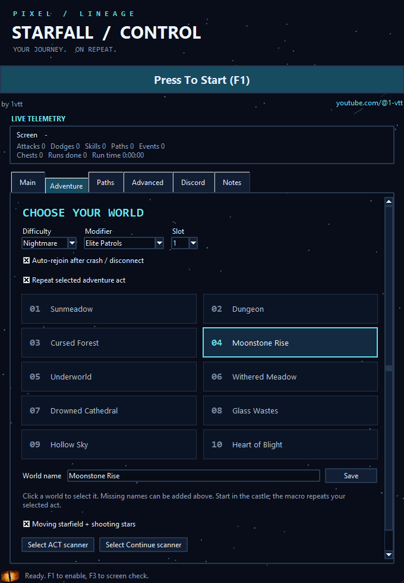

# Pixel Lineage - Starfall Macro

A modified Windows Python edition of **1vtt's Pixel Lineage Macro**, with adventure-act selection and a starry interface.

**Original creator: [1vtt](https://www.youtube.com/@1-vtt).** The original macro is the foundation of this project. Original credits are preserved; see [ATTRIBUTION.md](ATTRIBUTION.md).



## Features

- Ten clickable, named world cards; defaults to Moonstone Rise (act 4).
- Castle > Set Out > Find a Party > Host a Lobby setup with Nightmare and Elite Patrols.
- Right-arrow world selection, top-left act scanning, and return-home repeat logic.
- Reward-popup scanner that verifies and clicks Continue.
- Original combat, skill, minigame and path-selection controls.
- Drifting stars and shooting stars every 2.4 seconds, with an animation toggle.
- Optional Discord run logs and stuck alerts using the original webhook implementation.

## Install and run

1. Install 64-bit Python 3.10-3.13 with tkinter and the Python launcher.
2. Download [pixel-lineage-starfall-macro.zip](pixel-lineage-starfall-macro.zip) using GitHub's download button and extract it completely to a writable folder. The archive contains the full Python source and launchers. If you download the entire repository, also extract the macro ZIP inside it.
3. Run **Setup.bat** once. This creates a local .venv and downloads dependencies.
4. Run **Launch.bat**.
5. Open Roblox in the castle. Under **Adventure**, click the world you want, then press **F1** to start.

**F1:** start/stop. **F2:** minigame area. **F3:** screen check. **F4:** exit. Stop the macro before switching worlds.

Screen recognition and game logic run locally using Windows OCR. An English OCR language pack is required. Roblox still needs internet. Discord is optional and sends only when configured. Send test and stuck alerts include a Roblox screenshot.

## Worlds

1. Sunmeadow
2. Dungeon
3. Cursed Forest
4. Moonstone Rise
5. Underworld
6. Withered Meadow
7. Drowned Cathedral
8. Glass Wastes
9. Hollow Sky
10. Heart of Blight

Names are editable in the Adventure tab. Runtime settings are saved to config.json, which is deliberately ignored by Git because it can contain a Discord webhook URL. Do not publish your personal config.json or .venv.

## Calibration and current limits

The default controls match the supplied full-screen layout near 1920x1080. Other aspect ratios and UI layouts may need adjustment. Use the ACT and Continue scanner selectors to calibrate their capture areas. Keep the macro window clear of the game controls or enable Auto minimize.

Worlds must be unlocked. If the world selector does not wrap at act 10, begin at an earlier act. Unfamiliar Return Home confirmation dialogs may require manual input. The act-10 ending has not been verified live.

Nineteen automated control-flow tests pass; screenshot OCR, UI startup, and world-card selection were checked. The full live gameplay loop has not been validated end to end. This is a modified community tool, not an official Roblox or Pixel Lineage product.

## Development checks

```powershell
.venv\Scripts\python.exe test_adventure.py
.venv\Scripts\python.exe -m compileall -q src
```

## Credits

Please support the original creator, **1vtt**: https://www.youtube.com/@1-vtt

The combat/minigame engine and Discord webhook implementation come from the supplied original macro. This edition adds the adventure workflow and redesigned interface; it does not imply endorsement by the original creator.


## Recovery and event updates

Adventure now includes difficulty (Normal, Hard, Nightmare, Torment), modifier (No Modifier, Elite Patrols, Volatile Enemies, Exhausting Battles, Boss Rush), character slot 1-6, and an auto-rejoin toggle. The event scanner clicks an active To Battle button if it stays visible in the same position for five seconds.

Auto-rejoin recognizes central Roblox connection/error dialogs with Reconnect, Retry, OK, Leave or Quit, or a missing Roblox window lasting five seconds. It requests Pixel Lineage through Roblox's registered launch protocol, then recognizes Character Select and the selected slot's Enter button. Locked, empty or off-screen slots wait for manual intervention; it never clicks Unlock, Edit or Delete. After the castle appears, adventure setup restarts. Launch requests are spaced 90-300 seconds apart. A silent frozen client without a disconnect dialog is not detected. Roblox decides whether a launch request reuses or replaces its current client; simultaneous independent instances are not forced.

Recovery uses Roblox's documented deep-link format: https://create.roblox.com/docs/production/promotion/deeplinks

Screen recognition was checked against supplied title, slot and event screenshots; actual disconnection/rejoin has not been tested live. Source validation and 19 automated tests pass. Run all tests with `.venv\Scripts\python.exe -m unittest discover -p "test_*.py"`.

Return Home now clicks in three-click bursts, checks confirmation dialogs first, and repeats until the castle is detected. F1 stops the bursts.
